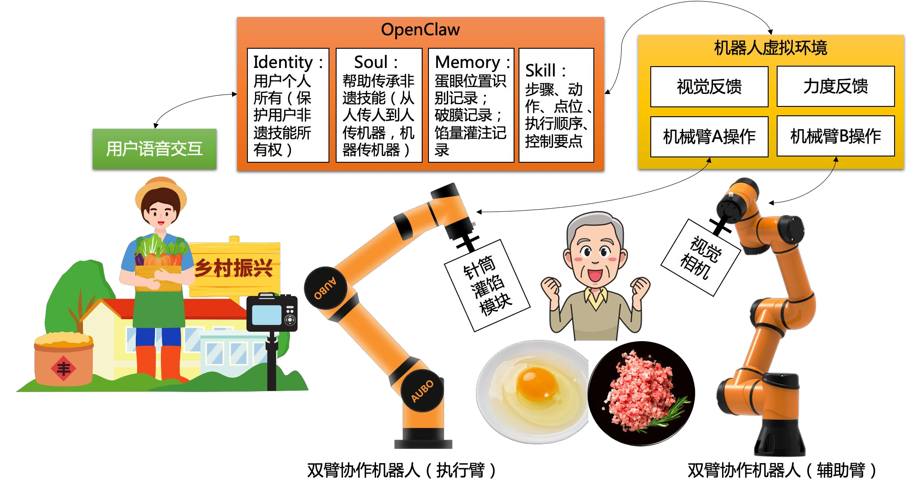
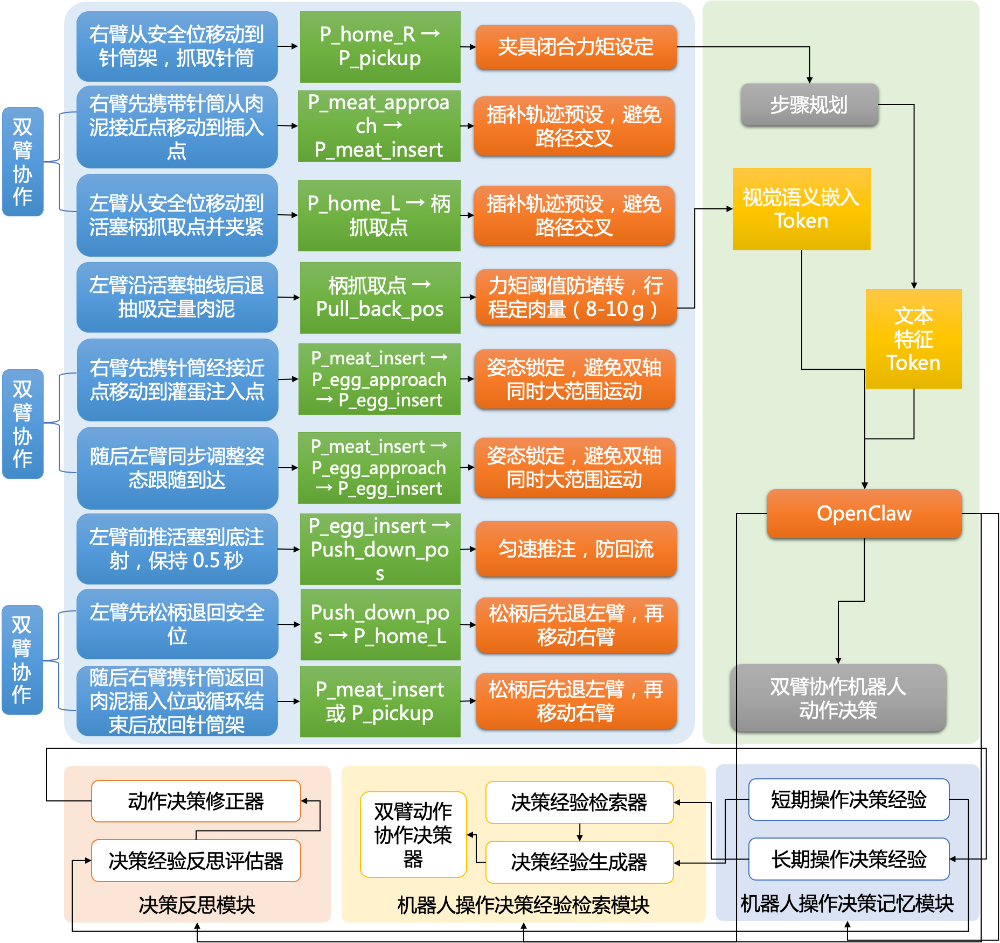
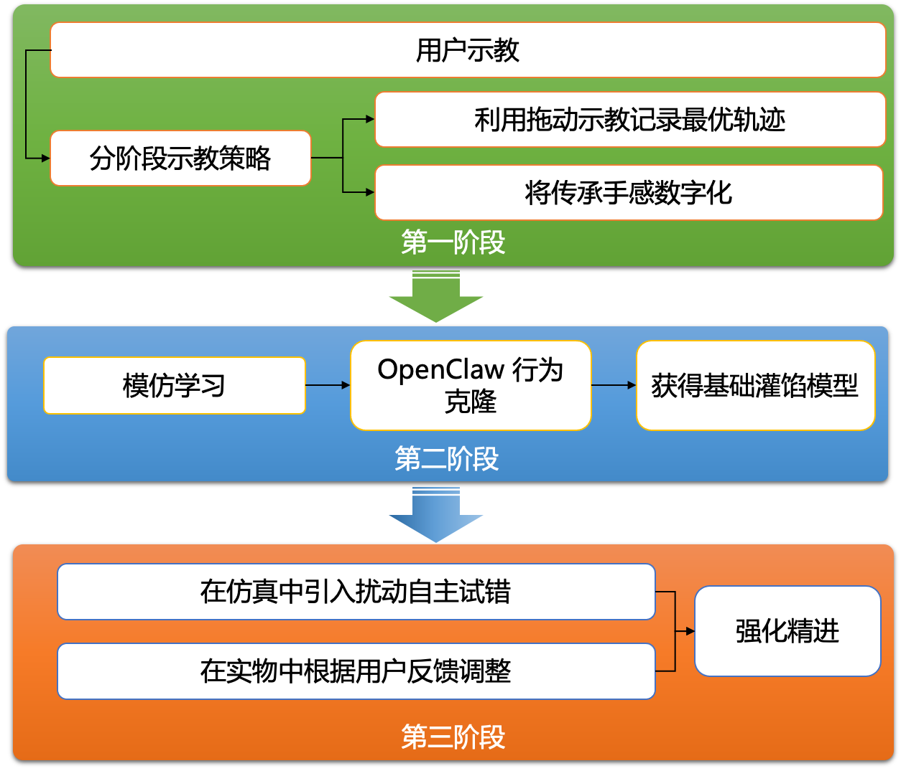

# 灵爪灌金 · 非遗智能灌蛋系统

> 基于多智能体协同框架 + AUBO-i5H 双臂协作机器人，实现福建顺昌仁寿灌蛋非遗技艺的智能协同作业

**第九届中国高校智能机器人创意大赛（主题一：家用智能机器人）全国三等奖作品**

---

## 项目背景

灌蛋是福建南平顺昌仁寿一带的传统小吃。做法看似简单——找到蛋眼、用筷子把肉馅灌进去——但要做到不破膜、不漏馅，需要长期练习：

- **蛋眼位置随机**：每颗蛋的蛋黄膜位置都不同，肉眼难以一眼定位
- **蛋黄膜极薄**：仅约 50–80 微米，力度稍大即破裂，整颗蛋报废
- **馅量无标准**：全凭手感，新手容易灌多撑破或灌少口感不佳

本项目用双臂协作机器人替代手工，让这门手艺可以被记录、复现与传播。

---

## 演示与材料

| 内容 | 说明 |
|:---|:---|
| [demo.mp4](media/demo.mp4) | 参赛演示视频（59 秒，H.264） |
| [作品展示 PPT](docs/灵爪灌金_PPT.pdf) | 14 页作品介绍（PDF 版，可直接在线预览） |
| [参赛材料.pdf](docs/参赛材料.pdf) | 完整参赛材料 |

> 视频体积超出 GitHub 内嵌预览限制，点击链接后请在页面右上角点 **Download** 下载观看。

---

## 系统架构



| 层 | 组件 | 职责 |
|:---|:---|:---|
| 决策层 | 多智能体协同框架 | 任务规划、异常决策、参数自适应 |
| 控制层 | 27 步操作序列 | 双臂协同动作编排 |
| 执行层 | AUBO-i5H 双臂 | 右臂灌注，左臂夹持固定 |

---

## 多智能体协作体系

项目不是单一智能体驱动，而是由多类智能体分工协作：

| 智能体 / 模型 | 承担角色 |
|:---|:---|
| **OpenClaw** | 核心多智能体运行时：任务编排、双臂协同决策、技能调度 |
| **DeepSeek** | 大模型推理：自然语言任务理解、异常场景决策 |
| **Codex** | 开发期辅助：控制逻辑生成、代码调试与迭代 |
| **Claude Code** | 开发期辅助：架构梳理、文档与报告生成 |

> 多智能体并非简单串联——OpenClaw 负责运行时编排，其余模型在开发与决策环节各司其职。

---

## 核心实现

### 双臂协同控制（`src/guandan_control.py`）

- **27 节点操作序列**：覆盖取蛋 → 定位蛋眼 → 针刺入 → 灌馅 → 退针 → 复位全流程
- **双臂分工**：右臂执行灌注动作，左臂负责蛋体夹持与姿态稳定
- **力控保护**：右臂 Z 轴力阈值 48g、左臂 12g，超阈值立即停止，防止戳破蛋黄膜
- **速度分级**：接近段与插入段采用不同线速度，兼顾效率与精度
- **蛋盘布局参数化**：3 行 × 9 列蛋盘，支持批量连续作业

```python
# 力控保护示例
right_arm.enable_force_control(axis="z", threshold=48.0, response="stop")
left_arm.enable_force_control(axis="z", threshold=12.0, response="stop")
```

### 操作流程演进




---

## 技术栈

| 类别 | 技术 |
|:---|:---|
| 多智能体框架 | OpenClaw（协同编排、技能调度） |
| 大模型 | DeepSeek（推理与决策） |
| 开发工具链 | Codex、Claude Code |
| 机器人平台 | AUBO-i5H 六轴协作机械臂 × 2（双臂系统） |
| 控制接口 | aubo_sdk（`Robot` / `MotionMode` / `ForceMode`） |
| 开发语言 | Python 3 |
| 文档生成 | fpdf2、python-docx |

---

## 目录结构

```
guandan-robot/
├── src/
│   ├── guandan_control.py    # 双臂灌馅主控程序（27 步操作序列）
│   ├── gen.py                # 参赛材料 PDF 生成
│   ├── generate_pdf.py       # 报告 PDF 生成
│   ├── generate_word.py      # 报告 Word 生成
│   ├── translate_doc.py      # 材料中英翻译
│   └── run.bat               # 一键运行
├── docs/
│   ├── architecture.png      # 系统架构图
│   ├── operation-flow.png    # 操作流程与控制模块
│   ├── flow-evolution.png    # 流程演进图
│   ├── 灵爪灌金_PPT.pdf      # 作品展示 PPT（14 页）
│   ├── 参赛材料.md           # 完整参赛说明
│   └── 参赛材料.pdf          # 参赛材料（打印版）
├── media/
│   └── demo.mp4              # 参赛演示视频
└── README.md
```

---

## 环境依赖

```bash
pip install aubo_sdk fpdf2 python-docx
```

> `aubo_sdk` 需配合 AUBO 机器人控制器使用。无实体设备时，可通过 AUBO 官方仿真环境运行。

## 运行

```bash
cd src
python guandan_control.py
```

运行前请确认双臂控制器 IP（默认 `192.168.1.100` / `192.168.1.101`）与示教点位已按实际工位标定。

---

## 成果

- 第九届中国高校智能机器人创意大赛（主题一）**全国三等奖**
- 相关技术已申请国家发明专利

## 团队

厦门工学院 · 人工智能学院
指导老师：王英杰、陈珍姗

---

## License

本项目仅供学习与学术交流使用。
